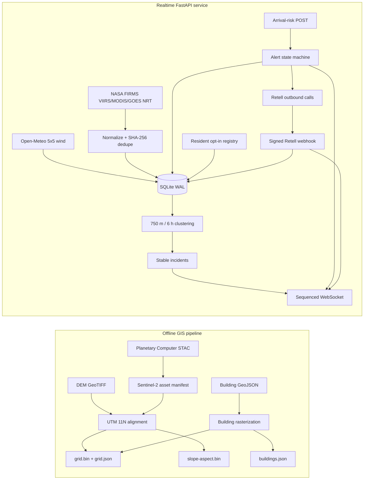
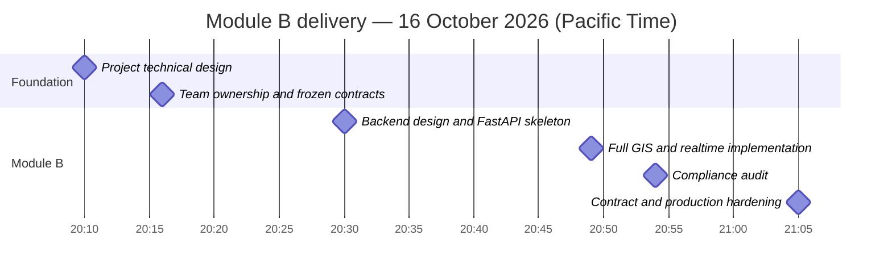
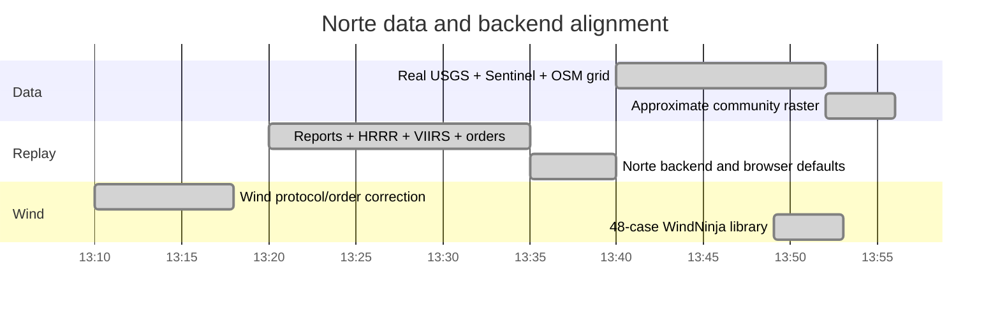

# Module B Delivery, Timeline, and README Compliance

- Audit date: 2026-10-17
- Audited branch: `b/backend`
- Scope: Module B — data preprocessing and the realtime backend owned by Tia

## 1. Executive summary

Module B now has a real Norte grid, a reproducible 48-case WindNinja library, a public-data
Norte replay, and a runnable FastAPI service. The delivered code covers the main vertical path
from source data to normalized hotspots, incidents, live messages, modeled alerts, resident
consent, and Retell call state.

The Norte pass uses a pre-fire 2026-10-14 Sentinel-2 scene, the 2026-09-15 USGS 1/3
arc-second DEM, 50,408 OSM footprints, and seven explicitly approximate communities. The server
now uses the Norte bbox, filters the Prima Deshecha landfill heat source, emits north-to-south
core wind fields, and defaults replay connections to Norte while preserving Eaton compatibility.

It is **not yet production-complete**. The remaining external or cross-module gaps are:

1. WFIGS currently returns no Norte perimeter, so final IoU remains pending rather than using a fabricated boundary;
2. Retell requires credentials and approved test numbers before its live path can be verified;
3. an authoritative CAP feed URL must be configured for deployment;
4. PII encryption at rest and distributed rate limiting remain production tasks.

These gaps do not invalidate the current MVP, but they must be resolved before claiming full README compliance or plug-and-play integration with modules A and C.

## 2. Delivered architecture



### Offline deliverables

- `wildfire-sentinel` discovers the newest low-cloud Sentinel-2 L2A scene.
- `wildfire-grid` reprojects DEM and Sentinel bands to EPSG:32611.
- NDVI produces the fuel layer; NDMI produces the dryness layer.
- SCL masks invalid, cloud, water, and shadow pixels.
- Building polygons are rasterized and preserved for display.
- Outputs are little-endian Float32 `grid.bin`, `slope-aspect.bin`, `grid.json`, and `buildings.json`.

### Realtime deliverables

- Five-minute configurable FIRMS polling for VIIRS, MODIS, and FIRMS GOES NRT.
- Hourly configurable Open-Meteo polling for a 5×5 wind grid in m/s.
- Idempotent hotspot storage and DBSCAN-style spatiotemporal clustering.
- Stable incident matching by shared hotspots or nearby centroids.
- REST snapshots plus sequenced WebSocket updates.
- Three-level alert rules with two-observation downgrade hysteresis.
- Resident opt-in/revocation and masked phone responses.
- Idempotent Retell call creation and signed webhook result handling.
- Readiness reporting for provider watermarks and Retell configuration.

## 3. Delivery timeline

The completed work is traceable to the repository history:



Norte alignment completed on 17 October:



## 4. README and team-plan compliance audit

Status meanings:

- **Compliant**: implemented and covered by automated tests.
- **Partial**: useful implementation exists, but differs from the stated contract or lacks a required production/integration piece.
- **Missing**: the documented behavior is not implemented in Module B.
- **Out of scope**: belongs to modules A or C and is not scored against Module B.

| Requirement | Status | Evidence | Gap or action required |
|---|---|---|---|
| DEM, Sentinel-2, buildings, and communities aligned to one grid | **Compliant for MVP** | `cli.py`, `sources.py`, `communities.py`; end-to-end tests | USGS and OSM source commands plus the frozen outputs are implemented. LANDFIRE and road/water masks remain optional enhancements. |
| Sentinel-2 L2A discovery and NDVI/NDMI/SCL processing | **Compliant for offline runs** | `sentinel.py` and `cli.py` | B04/B08/B8A/B11/SCL are supported. Schedule the CLI externally when periodic refresh is required. |
| NASA FIRMS VIIRS/MODIS polling | **Compliant** | `server/app/providers/firms.py`; provider tests | Requires a deployment FIRMS map key, as intended. |
| GOES-18 ABI FDC polling every five minutes | **Compliant** | `providers/goes.py`; generated NetCDF test; public NOAA smoke test | Direct S3 discovery, fixed-grid reprojection, fire-mask decoding, FRP, confidence, and bbox filtering are implemented. |
| Wind polling | **Compliant** | `server/app/providers/weather.py`; 5×5 grid test | Open-Meteo is implemented; NWS is an optional alternate source, not required for the MVP. |
| Hotspot dedupe and event clustering | **Compliant** | `store.py`, `clustering.py`, `service.py`; clustering/store tests | Current in-process algorithm is suitable for the MVP; production scale needs PostGIS or a spatial index. |
| Live WebSocket delivery | **Compliant** | `contracts.py`, `/ws?mode=live`, contract and API tests | Frozen top-level fields are emitted, with additive `sequence` and `emittedAt` metadata for reconnect safety. |
| Norte replay using the same frontend contract | **Compliant except final perimeter** | `norte.py`, archived WFIGS/HRRR/FIRMS inputs, bundled replay | Two reports, four VIIRS passes, hourly wind and five official orders are included. WFIGS has not published a perimeter, so final IoU is correctly left pending. |
| WindNinja terrain library | **Compliant** | `wind_library.py`, `web/public/data/wind/`, component/order tests | 16 directions × 3 speeds × 128² east/north vectors; north-wind direction and exact byte size validated. |
| Alert evaluation from deterministic arrival results | **Compliant at the service boundary** | single and batch risk endpoints; alert tests | Module C can POST deterministic scenario outputs in one batch. Direct in-process TypeScript invocation is intentionally avoided. |
| Retell calls for opted-in residents and result writeback | **Partial** | `retell.py`, `service.py`, signed webhook route | Code path is complete and idempotent, but live calls were not executed because no credentials/test numbers were provided. |
| Model output clearly marked non-official | **Compliant** | Alert WS payload and Retell variables include `non_official` | Keep this label visible in every frontend alert and spoken call script. |
| Relay and prioritize official evacuation orders | **Partial** | CAP poller, official-order store/API, `official_order` WS event with `official: true` | Storage and a separate authoritative channel exist. Configure an approved feed and enforce frontend precedence; automated official-order calls require policy approval. |
| Opt-in-only resident registry | **Compliant for MVP** | Consent validation, secret revocation token, rate limit, security headers, tests | Before production, add encryption at rest, shared/distributed rate limiting, retention automation, and legal review. |
| Crisis operation when the network is unavailable | **Partial / cross-module** | SQLite retains last successful realtime state | The README promises cached scenario playback. That requires precomputed scenarios from C and PWA caching from A; Module B does not yet publish a scenario catalog. |

### Other README features outside Module B

The following root README features are owned by A or C and were not evaluated as backend defects: Three.js terrain and fire rendering, GPU cellular automata, 64-member ensemble forecasting, treatment drawing, Dijkstra/min-cut planning, and Norte IoU calibration.

## 5. Interface differences that should be fixed first

The current live hotspot message is:

```json
{
  "type": "hotspots",
  "sequence": 1,
  "emittedAt": "2026-10-17T03:49:00Z",
  "items": [{
    "id": "...", "cell": 74588, "source": "VIIRS",
    "lat": 34.2, "lon": -118.1, "t": "2026-10-17T03:45:00Z",
    "frp": 12.5, "conf": 0.9
  }]
}
```

This now matches the frozen team fields. `cell` uses the same EPSG:32611 bounds and north-to-south row order as the offline grid. `sequence` and `emittedAt` are additive metadata; TypeScript consumers may ignore them or use them to detect gaps.

## 6. Verification performed

| Package | Verification | Result |
|---|---|---|
| Realtime server | Ruff plus unit/integration tests | 26 tests passed |
| Offline GIS pipeline | Seven CLI entry points, Ruff, unit/end-to-end tests | 9 tests passed |
| Frontend | TypeScript check plus Vite production build against real assets | Passed |
| Wind library | 48 WindNinja runs; exact-size/finite/vector-direction checks | Passed, 6,291,456 bytes |
| Direct GOES | Public NOAA GOES-18 object discovery and NetCDF decode | Passed; latest object decoded successfully |
| Secrets | Pattern scan and `.env.example` review | No committed credentials found |
| Git state | Local/remote revision comparison | Branch and remote matched at `2794ba1` before this report |

The automated suite uses mocked provider responses and synthetic rasters. It does not prove live FIRMS, Planetary Computer, Open-Meteo, or Retell availability. A credentialed staging smoke test is still required.

## 7. Acceptance checklist for full Module B completion

- [x] Python contract tests cover the frozen WebSocket field shape; add the same fixture to the TypeScript client when it lands.
- [x] Norte replay emits deterministic events through the same schema as live mode.
- [x] A generated `communities.json` maps community IDs to grid cells.
- [x] The batch arrival-risk boundary is covered by an API integration test.
- [ ] Official orders are stored and always take precedence over modeled alerts.
- [ ] One staging run records live FIRMS, GOES, wind, WebSocket, and Retell evidence.
- [ ] Resident endpoints have abuse controls and production PII protection.
- [ ] The demo continues with a documented last-known-state/scenario fallback when upstream APIs fail.
