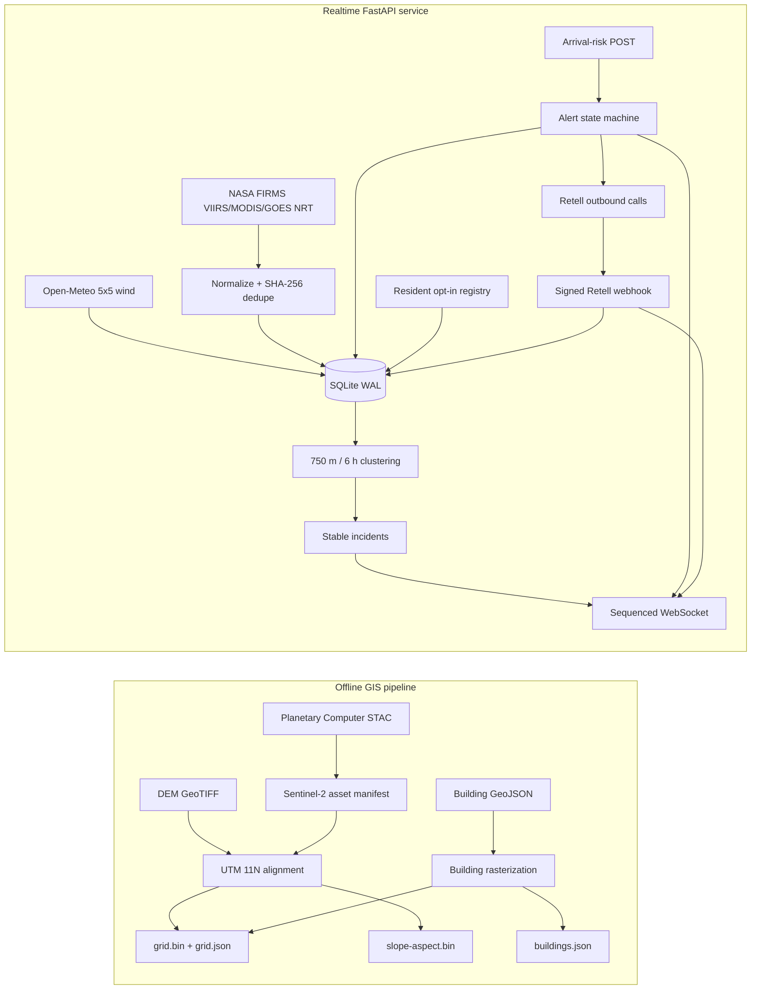
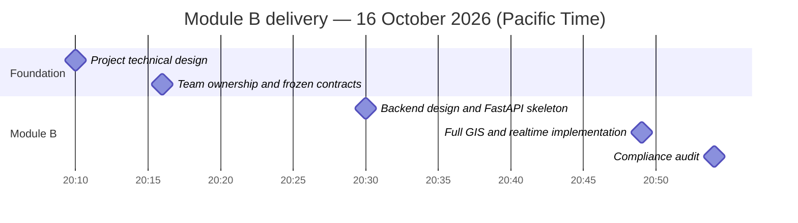
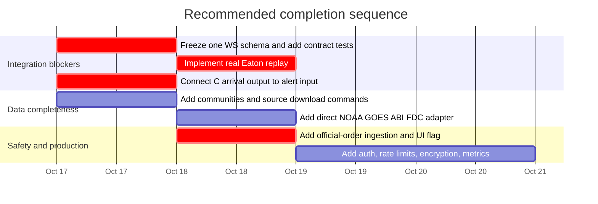

# Module B Delivery, Timeline, and README Compliance

- Audit date: 2026-10-16
- Audited revision: `2794ba1` on `b/data-realtime-backend`
- Scope: Module B — data preprocessing and the realtime backend owned by Tia

## 1. Executive summary

Module B now has a runnable offline GIS package and a runnable FastAPI service. The delivered code covers the main vertical path from source data to normalized hotspots, incidents, live messages, modeled alerts, resident consent, and Retell call state.

It is **not yet fully compliant** with every promise in the root README and the frozen contract in `docs/team-plan.md`. The largest integration gaps are:

1. the WebSocket envelope and field names differ from the frozen TypeScript contract;
2. `mode=replay&event=eaton` is accepted but does not replay an Eaton dataset;
3. GOES is consumed through FIRMS `GOES_NRT`, not directly from NOAA GOES-18 ABI-L2-FDCC;
4. official evacuation orders are not ingested or distinguished from modeled alerts;
5. the data pipeline aligns supplied files, but does not yet download DEM/building sources or generate `communities.json`;
6. the backend accepts arrival-risk results over REST instead of invoking the shared deterministic planner directly.

These gaps do not invalidate the current MVP, but they must be resolved before claiming full README compliance or plug-and-play integration with modules A and C.

## 2. Delivered architecture



### Offline deliverables

- `wildfire-sentinel` discovers the newest low-cloud Sentinel-2 L2A scene.
- `wildfire-grid` reprojects DEM and Sentinel bands to EPSG:32611.
- NDVI produces the fuel layer; NDMI produces the dryness layer.
- SCL masks invalid, cloud, water, and shadow pixels.
- Building polygons are rasterized and preserved for display.
- Outputs are little-endian Float32 `grid.bin`, `slope-aspect.bin`, `grid.json`, and `buildings.json`.

### Realtime deliverables

- Five-minute configurable FIRMS polling for VIIRS, MODIS, and FIRMS GOES NRT.
- Hourly configurable Open-Meteo polling for a 5×5 wind grid in m/s.
- Idempotent hotspot storage and DBSCAN-style spatiotemporal clustering.
- Stable incident matching by shared hotspots or nearby centroids.
- REST snapshots plus sequenced WebSocket updates.
- Three-level alert rules with two-observation downgrade hysteresis.
- Resident opt-in/revocation and masked phone responses.
- Idempotent Retell call creation and signed webhook result handling.
- Readiness reporting for provider watermarks and Retell configuration.

## 3. Delivery timeline

The completed work is traceable to the repository history:



Recommended path from the current MVP to a README-compliant demo:



## 4. README and team-plan compliance audit

Status meanings:

- **Compliant**: implemented and covered by automated tests.
- **Partial**: useful implementation exists, but differs from the stated contract or lacks a required production/integration piece.
- **Missing**: the documented behavior is not implemented in Module B.
- **Out of scope**: belongs to modules A or C and is not scored against Module B.

| Requirement | Status | Evidence | Gap or action required |
|---|---|---|---|
| DEM, Sentinel-2, and buildings aligned to one grid | **Partial** | `data-pipeline/wildfire_grid/cli.py`; end-to-end raster test | Alignment is implemented for supplied inputs. Add DEM/building download commands, road/water masks, LANDFIRE support, and `communities.json`. |
| Sentinel-2 L2A discovery and NDVI/NDMI/SCL processing | **Partial** | `wildfire_grid/sentinel.py` and `cli.py` | Scene discovery and processing work, but periodic refresh is not scheduled and B8A is not separately supported for NDMI. |
| NASA FIRMS VIIRS/MODIS polling | **Compliant** | `server/app/providers/firms.py`; provider tests | Requires a deployment FIRMS map key, as intended. |
| GOES-18 ABI FDC polling every five minutes | **Partial** | FIRMS adapter requests `GOES_NRT` | This is an aggregated FIRMS product, not a direct NOAA ABI-L2-FDCC object reader. Add a direct adapter if the README must be literal. |
| Wind polling | **Compliant** | `server/app/providers/weather.py`; 5×5 grid test | Open-Meteo is implemented; NWS is an optional alternate source, not required for the MVP. |
| Hotspot dedupe and event clustering | **Compliant** | `store.py`, `clustering.py`, `service.py`; clustering/store tests | Current in-process algorithm is suitable for the MVP; production scale needs PostGIS or a spatial index. |
| Live WebSocket delivery | **Partial** | `/ws?mode=live`, `RealtimeHub`, API integration test | Delivery works, but messages use `{type, sequence, emitted_at, data}`. The frozen team contract expects top-level fields, singular `incident`, `t`, `conf`, and hotspot `cell`. Choose one schema and add shared contract tests. |
| Eaton replay using the same frontend contract | **Missing** | Route validation accepts `mode=replay&event=eaton` | No replay dataset, clock, or replay event publisher is connected. |
| Alert evaluation from deterministic arrival results | **Partial** | `POST /api/v1/risks/evaluate`, `alerts.py` | Rules and persistence work. The backend does not directly call the shared TypeScript planner; module C must POST results or an adapter must be added. |
| Retell calls for opted-in residents and result writeback | **Partial** | `retell.py`, `service.py`, signed webhook route | Code path is complete and idempotent, but live calls were not executed because no credentials/test numbers were provided. |
| Model output clearly marked non-official | **Compliant** | Alert WS payload and Retell variables include `non_official` | Keep this label visible in every frontend alert and spoken call script. |
| Relay and prioritize official evacuation orders | **Missing** | No official-order provider or schema | Add CAL FIRE/Genasys/LA County ingestion, an `official_order` record, and precedence rules above model predictions. |
| Opt-in-only resident registry | **Compliant for MVP** | Pydantic requires `consent: true`; revoke endpoint and tests | Before production, add authenticated revocation, encryption at rest, retention rules, rate limits, and a legal review of call consent. |
| Crisis operation when the network is unavailable | **Partial / cross-module** | SQLite retains last successful realtime state | The README promises cached scenario playback. That requires precomputed scenarios from C and PWA caching from A; Module B does not yet publish a scenario catalog. |

### Other README features outside Module B

The following root README features are owned by A or C and were not evaluated as backend defects: Three.js terrain and fire rendering, GPU cellular automata, 64-member ensemble forecasting, treatment drawing, Dijkstra/min-cut planning, and Eaton IoU calibration.

## 5. Interface differences that should be fixed first

The current live hotspot message is effectively:

```json
{
  "type": "hotspots",
  "sequence": 1,
  "emitted_at": "2026-10-17T03:49:00Z",
  "data": {
    "items": [
      {
        "id": "...",
        "source": "VIIRS",
        "lat": 34.2,
        "lon": -118.1,
        "acquired_at": "2026-10-17T03:45:00Z",
        "frp": 12.5,
        "confidence": 0.9
      }
    ]
  }
}
```

The frozen team contract expects `items` at the top level and uses `t`, `conf`, and `cell`. Before frontend integration, the team should either:

1. change the server serializer to the existing TypeScript contract; or
2. update `docs/team-plan.md` and shared TypeScript types to adopt the sequenced envelope.

The second option preserves reconnect detection through `sequence`, but it requires explicit agreement from modules A and C because the team plan marks the interface as frozen.

## 6. Verification performed

| Package | Verification | Result |
|---|---|---|
| Realtime server | Ruff plus unit/integration tests | 15 tests passed |
| Offline GIS pipeline | Installed CLI entry points, Ruff, unit/end-to-end raster tests | 3 tests passed |
| Secrets | Pattern scan and `.env.example` review | No committed credentials found |
| Git state | Local/remote revision comparison | Branch and remote matched at `2794ba1` before this report |

The automated suite uses mocked provider responses and synthetic rasters. It does not prove live FIRMS, Planetary Computer, Open-Meteo, or Retell availability. A credentialed staging smoke test is still required.

## 7. Acceptance checklist for full Module B completion

- [ ] A shared schema test passes in both the Python server and TypeScript client.
- [ ] Eaton replay emits deterministic events through the same schema as live mode.
- [ ] A generated `communities.json` maps community IDs to grid cells.
- [ ] Module C arrival output reaches the alert API in an end-to-end test.
- [ ] Official orders are stored and always take precedence over modeled alerts.
- [ ] One staging run records live FIRMS, GOES, wind, WebSocket, and Retell evidence.
- [ ] Resident endpoints have abuse controls and production PII protection.
- [ ] The demo continues with a documented last-known-state/scenario fallback when upstream APIs fail.
